<div align="center">

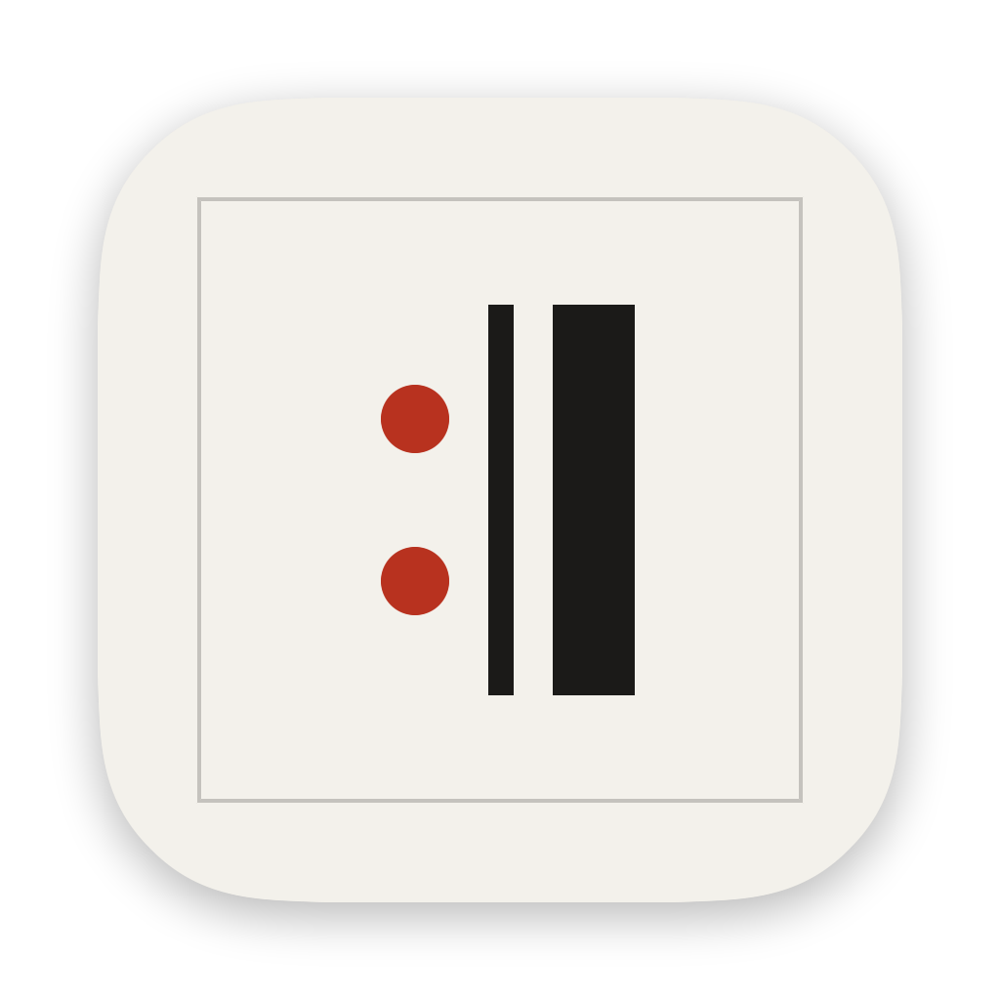

# Reprise

### Prompts you play again.

A native Mac prompt studio for people who live in Claude Code, Codex, Cursor and every other agent.<br/>
Templates, projects, a summon-anywhere panel, an MCP server, and an editor that doesn't choke on a 4 MB prompt.

<p>


</p>

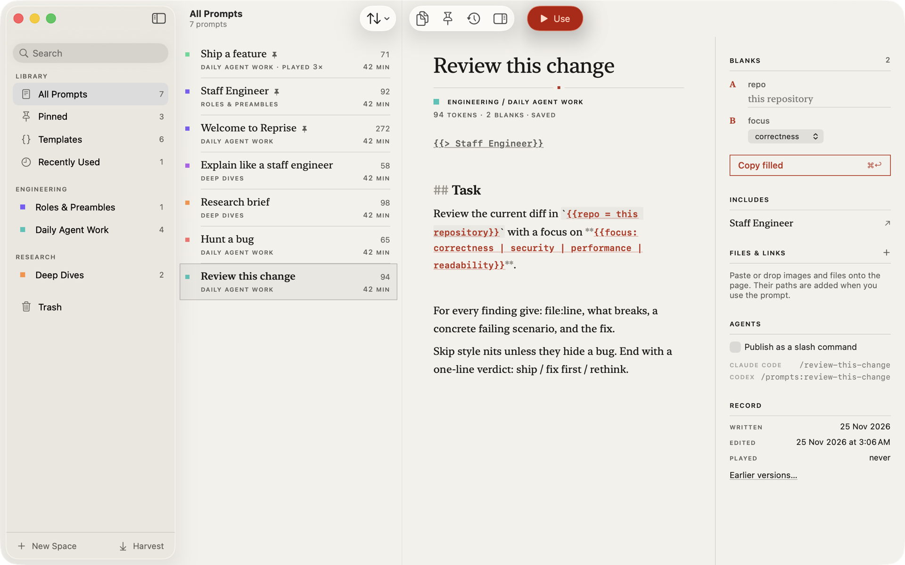

</div>

> **reprise** */rɪˈpriːz/*: in music, a theme that returns, often with variations.
> That's what a good prompt is. You write it once, and you play it again with different details, hundreds of times.

---

## Why

If you work with agents all day, you already have a prompt library. It's just in the worst possible places:

- **Apple Notes.** Paste a 60k-character spec and scrolling starts to stutter; at 130k it [becomes unusable](https://discussions.apple.com/thread/255765334).
- **Your shell history.** That 600-word "act as a staff engineer…" preamble, retyped or re-pasted for the 40th time. (Reprise's *Harvest* found one prompt its author had pasted into Codex **32 times**.)
- **Scattered `.md` files, Raycast snippets, browser extensions.** No variables, no projects, nothing your agents can reach.

Reprise is one fast, beautiful home for all of it, wired directly into the tools where prompts are used.

## What it does

### ⌥⌘P: summon, type, paste
A Spotlight-style panel over any app. Fuzzy full-text search, ↑↓, ↩. Templates turn into a tiny inline form (Tab between blanks), and the result is pasted straight into your terminal. It never steals focus from your agent.

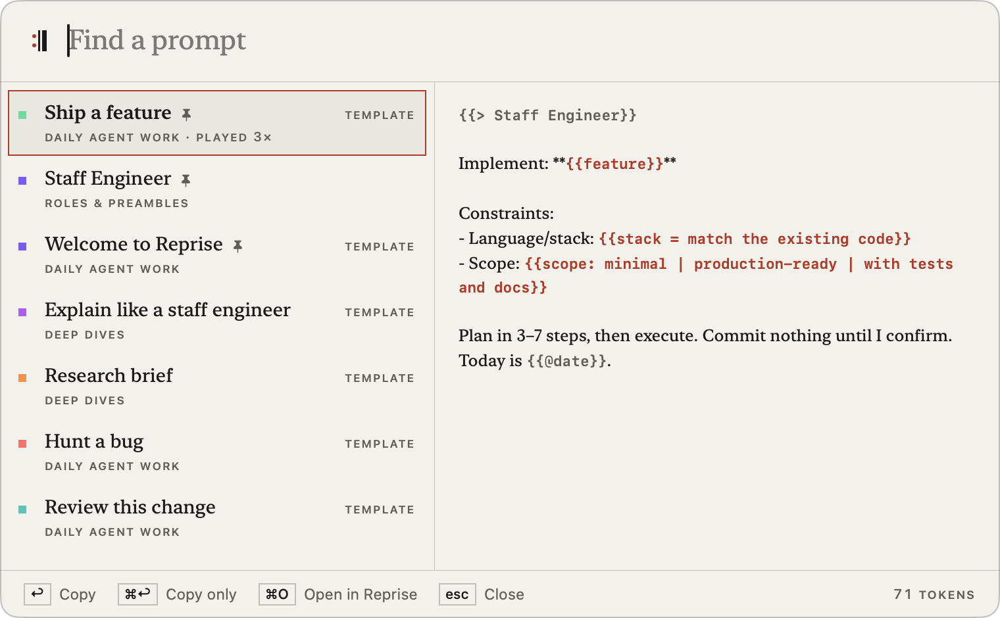

### Templates that read like plain text
| Syntax | Meaning |
|---|---|
| `{{file}}` | a blank you fill in |
| `{{lang = Swift}}` | a blank with a default |
| `{{tone: terse \| friendly \| formal}}` | a choice (first option is the default) |
| `{{@date}}` `{{@time}}` `{{@clipboard}}` `{{@uuid}}` | built-ins, resolved when used |
| `{{> Staff Engineer}}` | **include** another prompt by name, so you write a role preamble once and reuse it everywhere |
| `\{{literal}}` | escape |

Reprise remembers the values you used last time, shows a live preview with a token count, and never mistakes code like `style={{ color: 'red' }}` for a variable.

### The page and its margin
The main window is set like a book, not a notes app. The prompt sits on a readable measure, and everything *about* it lives in the margin beside it: the **blanks** (keyed A, B, C) you can fill right there, the prompts it **includes**, its **files and links**, its **agent commands**, and its **record** (written, edited, played, earlier versions). Fill the blanks and press ⌘↩. The margin toggles with ⌥⌘0.

### Spaces → Projects → Prompts, all named and all colored
Organise by area (Client work, Research, Open source…) and by project. Every space, project and prompt has a **required name** and its own color. New ones get a random shade drawn from an effectively infinite **OKLCH** pool, so every hue has the same perceived brightness and they all look good together. Click the color key for another random shade or for "shades near this one". Drag prompts between projects.

### Agent-native, not agent-adjacent
- **MCP server:** `claude mcp add reprise -- reprise mcp`. Agents can `search_prompts`, render with `get_prompt`, and **`save_prompt`** ("save that as a Reprise template"). Pinned prompts appear as native `/mcp__reprise__…` commands with their variables as arguments.
- **Slash commands:** mark a prompt as an *Agent Command* (⇧⌘T) and it's published to `~/.claude/commands/<slug>.md` (`/slug`) and `~/.codex/prompts/<slug>.md` (`/prompts:slug`). Variables become `$1 $2…` with an `argument-hint`. Reprise only manages files it wrote and never touches yours.
- **CLI:** `reprise cast "Hunt a bug" --var symptom="login 500s" -c`, plus `ls`, `search`, `add` (from stdin), `export`, `sync`.
- **Harvest:** reads `~/.claude/history.jsonl` and `~/.codex/history.jsonl` locally, clusters near-duplicates, and ranks the prompts you keep retyping by how much retyping they cost you. One click turns them into templates.

### Images, files and links, the way agents want them
Paste a screenshot (⌘V) or drop files onto a prompt and they're copied into the library, so they never break when Downloads gets cleaned. When you use the prompt, absolute paths and URLs are appended, which is exactly what Claude Code and Codex read. Thumbnails, Quick Look, drag-out and copy-image all work.

### An editor built for long prompts
AppKit **TextKit 2** with viewport-based layout, so a 4 MB prompt scrolls like a 4 KB one. Markdown, XML-style prompt tags (`<task>`, `<context>`), code fences, links and template placeholders are highlighted **incrementally**: only the paragraphs you touch are re-styled. Smart quotes and autocorrect are off by default, because prompts are code. Autosave, version history (restore any of the last 50 versions), word and token counts, and find & replace.

### Three designs, each with three looks
Reprise ships in three complete designs. They aren't themes. Each has its own type, keys, selection, density and icon, and each is built as a separate app, so you can install them side by side and compare. Switch any app's design in **Settings → Appearance** or **View → Design**.

| | Edition | Machined | Quiet |
|---|---|---|---|
| |  | 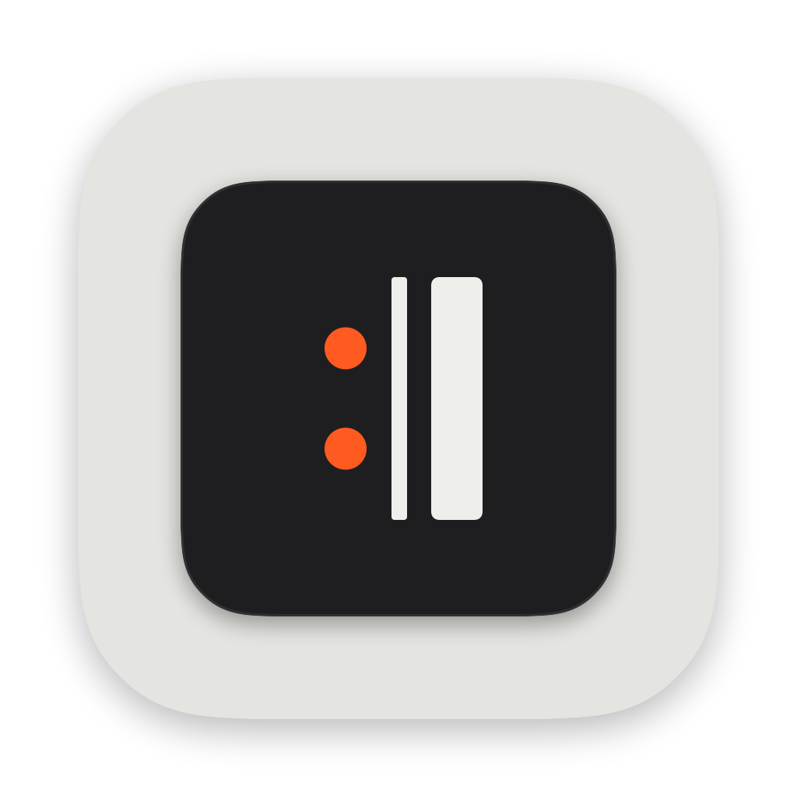 |  |
| Idea | A well-set book page: serif text, small-caps apparatus, vermilion rubrics | A precision instrument: grotesk, numbered keys, one orange signal | A gallery wall: light type, wide air, ink blue |
| Blanks keyed | A B C | 1 2 3 | i ii iii |
| Looks | Bone · Iron · Vellum | Aluminum · Graphite · Glass | Day · Night · Haze |


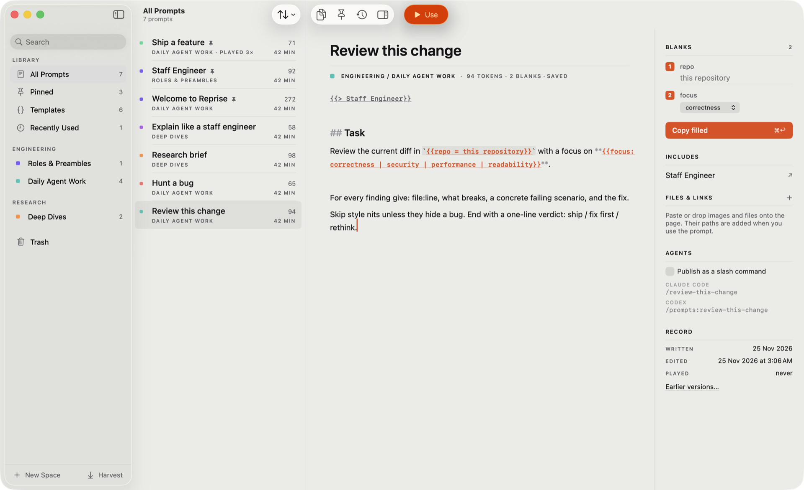
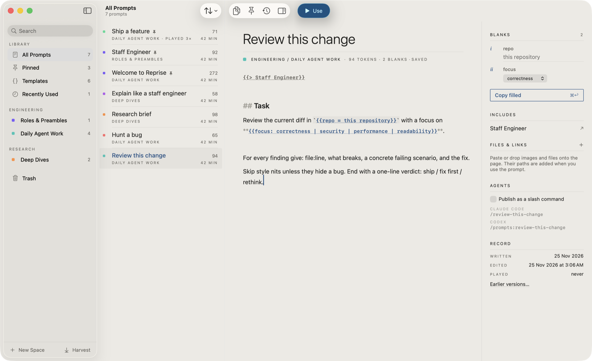

Each design has a light look, a dark look, and a glass look that lets your desktop show through (Vellum, Glass, Haze). Cycle the looks with ⇧⌘L.

| Edition · Iron | Machined · Graphite | Quiet · Night |
|---|---|---|
| 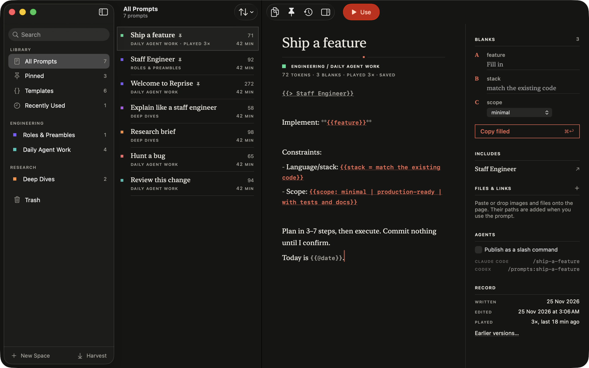 | 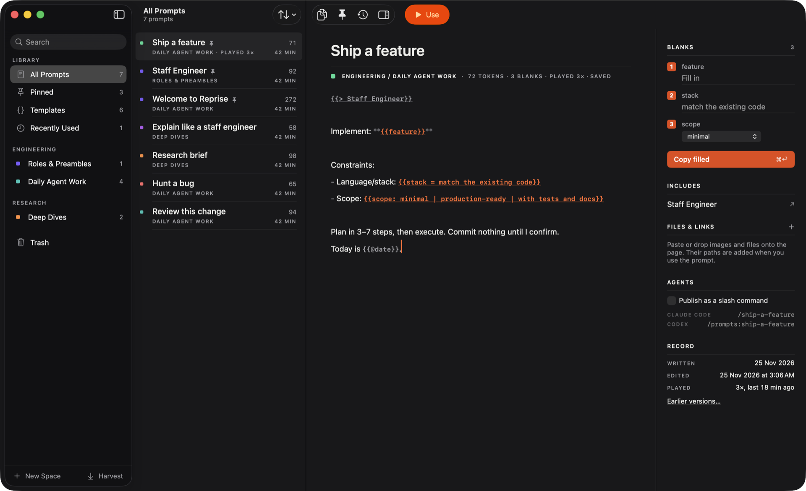 | 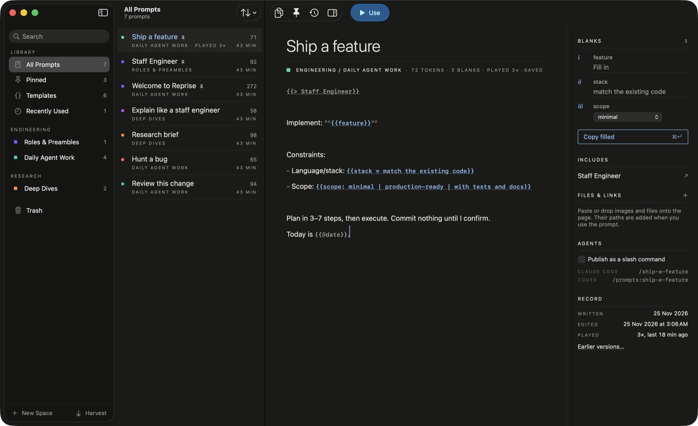 |
|  | 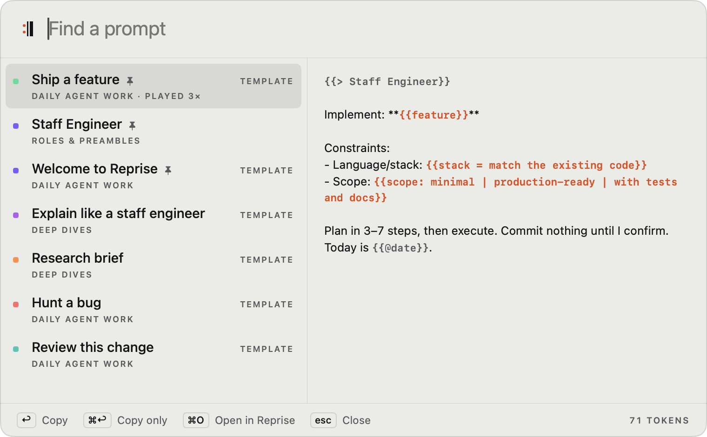 | 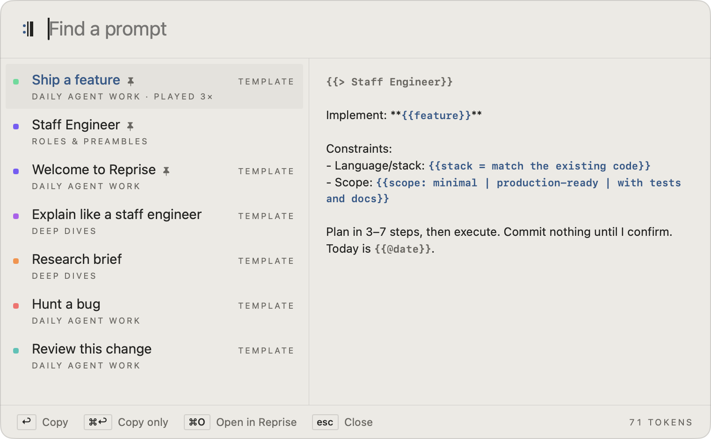 |

## Fast, on purpose

`swift run -c release reprise-bench` on an M4, with **50,000 prompts plus one 4 MB prompt** in the library:

| Operation | Time |
|---|---|
| Exact full-text search | **0.1 ms** |
| Prefix search, 200 hits ranked (bm25) | 46 ms |
| Load a 4 MB prompt | 0.5 ms |
| Save a 4 MB prompt (FTS re-indexed) | 53 ms |
| Render a 4 MB template (56k placeholders) | 138 ms |
| List 5,000 rows | 104 ms |
| Bulk-insert 50,000 prompts | 2.6 s |

How: lists never load prompt bodies, only a 280-char snippet. SQLite runs with WAL, mmap, cached prepared statements and an **FTS5** index kept in sync by triggers. The editor is TextKit 2. Saves are debounced and run off the main thread. Thumbnails are downsampled with ImageIO. The whole app is **4.2 MB** with zero dependencies.

### Why not Rust? Why not Electron?
Notes doesn't lag because Swift is slow. It lags because of *how it lays out and stores text*. The fix is architectural: viewport-based text layout, an indexed store, and never touching full bodies in lists. Rust would add an FFI boundary and buy nothing over SQLite's C core. Electron would cost 150 MB of RAM. And real macOS 26 glass, menus and text input only exist natively. Reprise is Swift 6, SwiftUI, AppKit and SQLite, nothing else.

## Install

**Download:** grab a zip from [Releases](https://github.com/thekeenest/reprise/releases): `Reprise.zip` (Edition), `Reprise-Machined.zip` or `Reprise-Quiet.zip`. Unzip and move it to Applications. Each design is its own app with its own settings, and they all share one library. If you run two at once, give one a different Quick Panel shortcut in Settings. The builds are ad-hoc signed, not notarized yet, so on first launch run:
```bash
xattr -dr com.apple.quarantine /Applications/Reprise*.app
```

**From source** (macOS 26, Xcode 26 or Command Line Tools):
```bash
git clone https://github.com/thekeenest/reprise && cd reprise
scripts/build-app.sh --install     # builds, installs to /Applications, links the CLI to ~/.local/bin/reprise
scripts/build-app.sh --all         # builds all three designs into dist/ to compare them
scripts/build-app.sh --world Quiet # just one
```

**Wire up your agents:**
```bash
claude mcp add reprise -- reprise mcp
codex mcp add reprise -- reprise mcp
```

## Keyboard

| | |
|---|---|
| ⌥⌘P | Quick Panel from anywhere (configurable) |
| ⌘N / ⇧⌘N / ⌥⌘N | New prompt / project / space |
| ⌘↩ | Use: fill & copy |
| ⌥⌘0 | Show or hide the margin |
| ⇧⌘C | Copy source |
| ⇧⌘P | Pin |
| ⇧⌘T | Toggle agent command |
| ⇧⌘K | Shuffle color |
| ⇧⌘H | Harvest from agent history |
| ⇧⌘L | Next look (light, dark, glass) |
| ⌘F | Find & replace in prompt |

## Your data

Everything lives in `~/Library/Application Support/Reprise/` as one SQLite file plus an `Attachments` folder. Nothing is sent anywhere: no account, no telemetry, no network calls. Export the whole library to Markdown (with YAML front matter) any time, or import a folder of `.md` files. Set `REPRISE_HOME` to keep the library somewhere else, such as a synced folder.

## Project layout

```
Sources/RepriseCore     the engine: SQLite store, FTS5, template language, Harvest, agent sync, Markdown I/O
Sources/RepriseApp      SwiftUI + AppKit app: TextKit 2 editor, Quick Panel, three designs
Sources/reprise         CLI + MCP server (stdio JSON-RPC)
Sources/reprise-bench   correctness checks + performance benchmark
Tests/                  XCTest suite (run in Xcode / CI)
DESIGN.md               the three design systems, token by token
docs/                   research, launch plan, assets
```

## Roadmap

- [ ] Notarized builds + `brew install --cask reprise`
- [ ] iCloud / folder sync between Macs
- [ ] Per-prompt global hotkeys
- [ ] Prompt diff view across versions
- [ ] Team libraries (shared spaces via git)
- [ ] Linux and Windows builds of the core and CLI

## License

MIT © [thekeenest](https://github.com/thekeenest)
